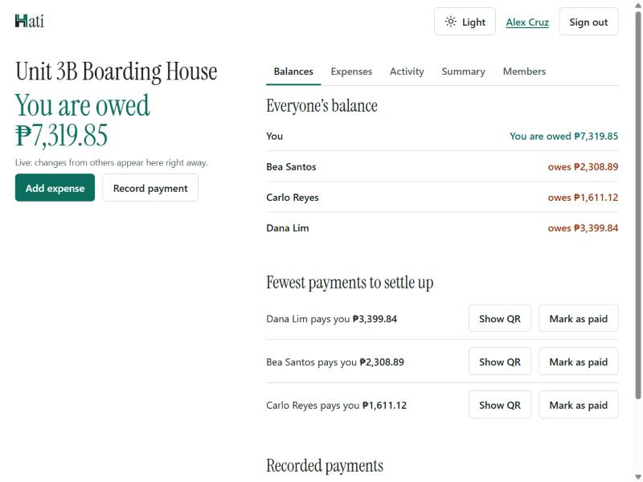
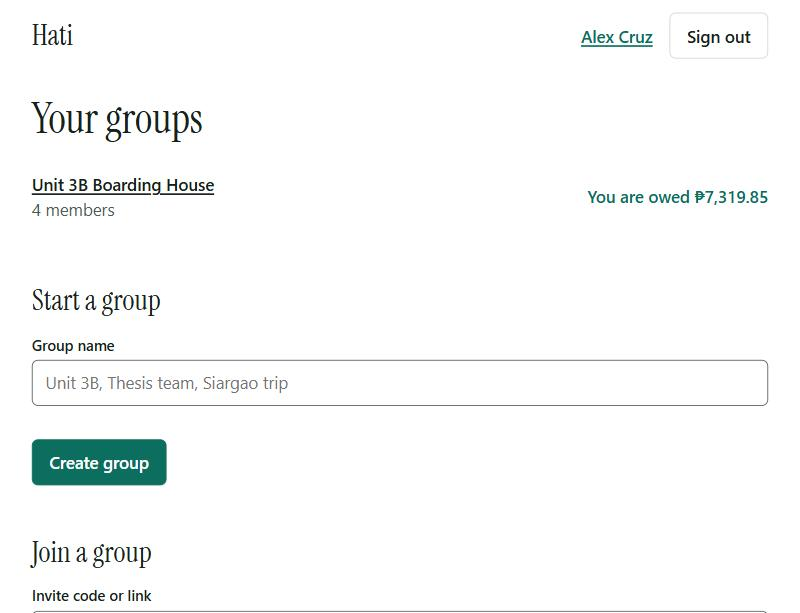
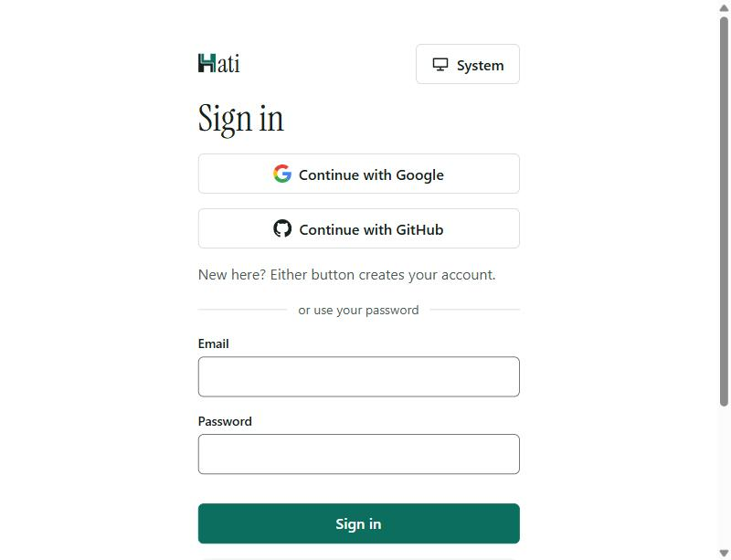
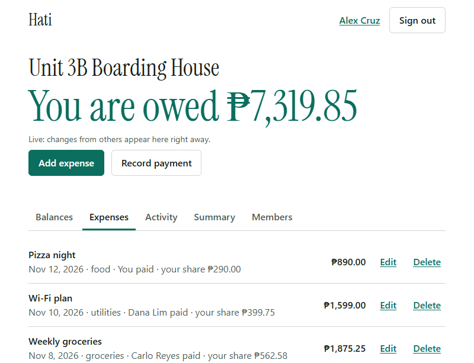
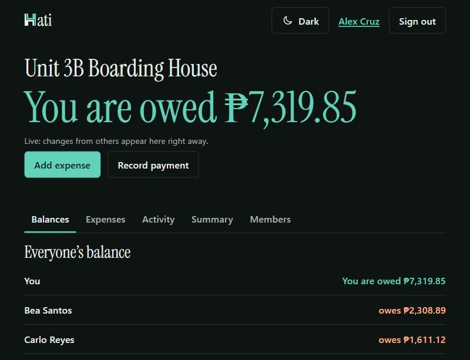
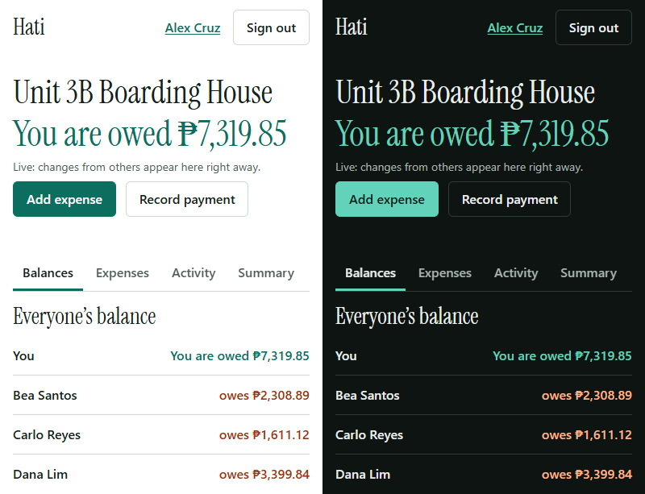

<a id="top"></a>

<p align="center"></p>
<h1 align="center">Hati</h1>
<p align="center">A shared expense splitter with live balances.</p>

<p align="center">
  <a href="LICENSE"></a>
  <a href="https://github.com/Jevoel16/Hati/actions/workflows/ci.yml"></a>
  
</p>

<p align="center">
  <a href="#about">About</a> · <a href="#screenshots">Screenshots</a> · <a href="#features">Features</a> · <a href="#tech-stack">Tech Stack</a> · <a href="#getting-started">Getting Started</a> · <a href="#configuration">Configuration</a> · <a href="#usage">Usage</a> · <a href="#more">More</a> · <a href="#contributing">Contributing</a> · <a href="#license">License</a> · <a href="#author">Author</a>
</p>

---

## About

Hati (Filipino for "to split") is for housemates, project groups and friends who share costs and are tired of tracking them in a group chat. Everyone in a group records what they paid, Hati works out who owes whom to the centavo, and every member sees the balances change the moment an expense is added. It keeps records only and never moves money. Try it at [hati.jevoelorbilla.dev](https://hati.jevoelorbilla.dev). Built as the ITE183 final project; the reasoning behind its main choices is in [docs/decisions.md](docs/decisions.md).

## Screenshots

<details>
<summary><b>Screenshots</b></summary>

<table>
  <tr>
    <td width="50%" align="center"><b>Group balances</b><br><a href="docs/images/balances.png"></a></td>
    <td width="50%" align="center"><b>Your groups</b><br><a href="docs/images/groups.png"></a></td>
  </tr>
  <tr>
    <td width="50%" align="center"><b>Sign in</b><br><a href="docs/images/sign-in.png"></a></td>
    <td width="50%" align="center"><b>Expenses</b><br><a href="docs/images/expenses.png"></a></td>
  </tr>
  <tr>
    <td width="50%" align="center"><b>Dark mode</b><br><a href="docs/images/dark-mode.png"></a></td>
    <td width="50%" align="center"><b>Phone (light and dark)</b><br><a href="docs/images/phone.png"></a></td>
  </tr>
</table>

</details>

## Features

- Groups you join with an invite link or code, with admins and members
- Expenses split equally, by exact amounts or by percentage
- Each member's balance, and the fewest payments that settle the whole group
- Balances and an activity feed that update live, with no refresh
- Recorded payments that adjust everyone's balance
- Spending summary by category and by month
- Sign-in with Google or GitHub, plus a public demo account
- A username and password chosen on first sign-in
- Phone-first layout with a system, light or dark theme switch and full keyboard access

## Tech Stack

| Layer     | Tools                                                                          |
| --------- | ------------------------------------------------------------------------------ |
| Front end | React 19.3.1, React Router 7.18.5, Vite 8.3.8, plain CSS                       |
| Back end  | Node.js 26.13.1, Express 5.3.0, ws 8.23.0, Zod 4.6.7, TypeScript 6.0.3         |
| Database  | TiDB (MySQL protocol) through mysql2 3.24.6                                    |
| Hosting   | Vercel (static site, API and WebSocket in one function), TiDB Cloud            |
| Analytics | Vercel Web Analytics through @vercel/analytics 2.0.1                           |
| Tooling   | node:test through tsx 4.23.15, ESLint 10.15.0, Prettier 3.10.1, GitHub Actions |

## Getting Started

You need Node.js 26 and a TiDB database (a free TiDB Cloud Serverless cluster works).

```bash
npm install
cp .env.example .env   # then fill in DATABASE_URL and JWT_SECRET
npm run migrate
npm run seed
npm run dev
```

Open http://localhost:5173 and use "Open the demo".

## Configuration

All settings are environment variables; [.env.example](.env.example) lists them for local, development and production use.

<details>
<summary>Environment variables</summary>

| Variable                                   | Required   | Purpose                                                      |
| ------------------------------------------ | ---------- | ------------------------------------------------------------ |
| `NODE_ENV`                                 | no         | `development`, `test` or `production`                        |
| `PORT`                                     | no         | API port for local development (default 3000)                |
| `APP_URL`                                  | yes        | Public address of the site; used for OAuth callbacks and SEO |
| `DATABASE_URL`                             | yes        | `mysql://` connection string for TiDB                        |
| `TEST_DATABASE_URL`                        | tests only | A TiDB server where tests may create and drop databases      |
| `JWT_SECRET`                               | yes        | At least 32 random characters; signs the session cookie      |
| `GOOGLE_CLIENT_ID`, `GOOGLE_CLIENT_SECRET` | no         | Turns on Google sign-in                                      |
| `GITHUB_CLIENT_ID`, `GITHUB_CLIENT_SECRET` | no         | Turns on GitHub sign-in                                      |
| `CRON_SECRET`                              | production | At least 16 characters; protects the daily maintenance route |

</details>

## Usage

1. Sign in with Google or GitHub and choose a password, or open the demo.
2. Create a group and send its invite link to the others.
3. Add expenses as they happen and pick how each one is split.
4. Check the Balances tab for the fewest payments that settle up, and record each payment once it is made.

Guides: [API reference](docs/api.md) · [Deploying to Vercel](docs/deploy.md) · [Security](docs/security.md) · [State machines](docs/state-machines.md) · [Performance](docs/performance.md)

## More

<details>
<summary>Project structure</summary>

```
api/       Vercel Function entry (re-exports the server)
server/    Express API: routes -> services -> data layer, plus pure money logic
web/       React app and the static landing page
docs/      Decisions, API, security, state machines, deployment
docker/    Dockerfiles for the web, API and database containers
```

</details>

<details>
<summary>Scripts</summary>

| Script              | What it does                                     |
| ------------------- | ------------------------------------------------ |
| `npm run dev`       | API on port 3000 and web app on port 5173        |
| `npm run build`     | Builds the web app into `public/`                |
| `npm test`          | Unit tests, plus API tests when a test DB is set |
| `npm run typecheck` | Type-checks the server and the web app           |
| `npm run lint`      | ESLint                                           |
| `npm run format`    | Prettier                                         |
| `npm run migrate`   | Applies database migrations                      |
| `npm run seed`      | Creates or resets the demo account               |

</details>

## Contributing

Work on a `feat/...` or `fix/...` branch and write [Conventional Commits](https://www.conventionalcommits.org) such as `feat: add CSV export`. Versions are bumped only at a release. Update this README with every change.

## License

[Sprucetrap Source-Available License 1.0](LICENSE) © 2026 Sprucetrap (github.com/Jevoel16). Free for personal, educational and other non-commercial use with credit; commercial use needs written permission.

## Author

[Jevoel16](https://github.com/Jevoel16) (Sprucetrap), for ITE183 Web Systems and Technologies.

<p align="right"><a href="#top">Back to top</a></p>
