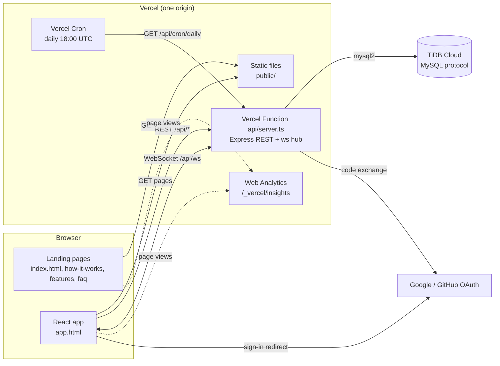
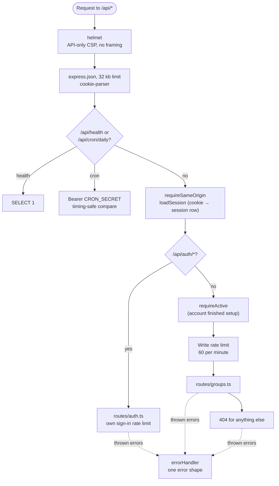
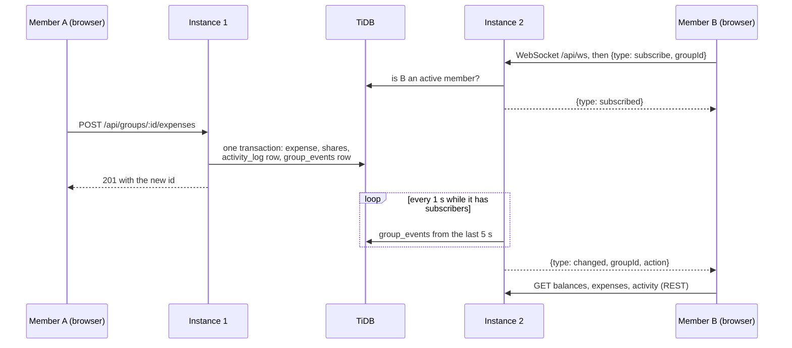
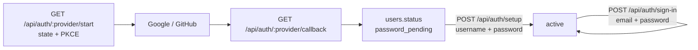
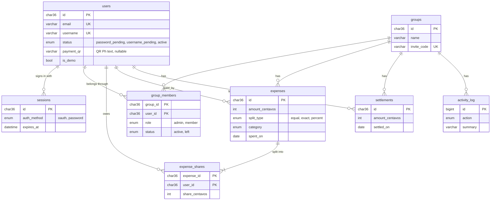

# Architecture

How Hati is put together, from the browser to the database. The reasons behind the main choices are in [decisions.md](decisions.md); this page says what exists and where it lives.

## Overview

Everything runs on one origin: Vercel serves the static pages and routes `/api/*`, including the WebSocket, to a single Vercel Function. That function holds the whole Express app and talks to one TiDB Cloud database ([decision 1](decisions.md#1-everything-on-vercel-including-the-websocket), [decision 2](decisions.md#2-tidb-instead-of-postgresql)).

| Piece        | Where                                 | Notes                                                                                    |
| ------------ | ------------------------------------- | ---------------------------------------------------------------------------------------- |
| Static site  | `web/` built into `public/`           | Four HTML entries, hashed assets cached for a year (`vercel.json`)                       |
| API + socket | `api/server.ts` → `server/src/app.ts` | One function, `maxDuration` 300 s, so a socket lives at most 5 minutes                   |
| Database     | TiDB Cloud Serverless                 | Migrations and the demo seed run on every deploy (`npm run vercel-build`)                |
| Daily job    | `/api/cron/daily`                     | Resets the demo, prunes expired sessions, old rate-limit rows and day-old `group_events` |
| Sign-in      | Google and GitHub                     | Hand-written OAuth code flow with state and PKCE (`server/src/services/oauth.ts`)        |
| Analytics    | `@vercel/analytics`                   | Same-origin script; ids and invite codes stripped in `web/src/lib/analytics.ts`          |

## Request path

Every REST request passes through the same chain, wired in one place, `server/src/app.ts`:

The WebSocket upgrade skips Express but gets the same checks in `server/src/routes/live.ts`: the Origin must be this site, and the session cookie must belong to an `active` account.

## Server layers

Dependencies point one way: routes → services → data layer, with pure logic in `domain/` that touches nothing outside itself.

| Folder / file            | Job                                                                                                   |
| ------------------------ | ----------------------------------------------------------------------------------------------------- |
| `server/src/routes/`     | Parse the request with Zod (`schemas.ts`), call one service, send JSON. No business rules.            |
| `server/src/services/`   | The use cases: auth, OAuth, groups, ledger (expenses and payments), payment QRs, demo, live hub.      |
| `server/src/data/`       | SQL for one table family each (`users`, `sessions`, `groups`, `ledger`, `activity`, `rateLimits`).    |
| `server/src/domain/`     | Pure functions: `money`, `split`, `balances` (settle-up plan), `qrph` (QR Ph parse/build), `machines` |
| `server/src/middleware/` | Session loading, `requireActive`, same-origin check, rate limit, central error handler.               |
| `server/src/context.ts`  | `Ctx`: db, config, fetch, bcrypt cost and sign-in limit, passed into everything so tests can swap it  |
| `server/src/config.ts`   | Reads and validates environment variables once at startup; a missing one stops the server.            |
| `server/src/db.ts`       | `mysql2` pool with `query` and `transaction` (retries a deadlocked transaction up to 3 times).        |

Money is integer centavos end to end ([decision 5](decisions.md#5-money-is-integer-centavos)). Shares of an expense are split in `domain/split.ts`, and `domain/balances.ts` turns all expenses and payments into balances and the fewest payments that settle the group ([decision 6](decisions.md#6-fewest-payments-is-a-greedy-algorithm)).

## Live updates

Serverless instances do not share memory, so the instance that saves an expense cannot reach a socket held by another one. Instead, every write leaves a row in `group_events`, and every instance with subscribers polls that table ([decision 3](decisions.md#3-live-updates-by-polling-a-small-events-table), [decision 4](decisions.md#4-the-socket-says-changed-not-what-changed)).

- Owners: `server/src/services/live.ts` (hub and polling), `server/src/routes/live.ts` (upgrade checks, 30 s ping), `server/src/data/activity.ts` (event rows), `web/src/lib/hooks.ts` (`useLive`).
- The poll looks back 5 seconds and skips ids it has already sent, so a slow commit is not missed.
- On a `member_left`, `member_removed` or `group_deleted` event the hub re-checks each subscriber's membership and drops anyone no longer active.
- Vercel closes the socket when the function reaches 300 s. The browser treats that as normal: it reconnects after 1, 2, 4… seconds (at most 15) and refetches once subscribed again.

## Auth and sessions

- The cookie `hati_session` (httpOnly, SameSite Lax, Secure in production) holds a JWT with only a session id. Each request looks that id up in `sessions`, so sign-out and password changes end sessions at once ([decision 8](decisions.md#8-a-signed-cookie-that-points-at-a-session-row)).
- Passwords are hashed with bcrypt. Accounts created before usernames existed sit in `username_pending` until they pick one.
- Account and membership states are listed in [state-machines.md](state-machines.md); the security measures are in [security.md](security.md).

## Data model

From `server/migrations/` (001 creates the tables, 002 adds usernames, 003 adds payment QRs).

Two tables stand apart: `group_events` (the short-lived outbox for live updates, with no foreign key so a "group deleted" event outlives its group) and `rate_limits` (fixed-window counters, [decision 9](decisions.md#9-rate-limits-live-in-the-database)).

TiDB enforces `ENUM` and foreign keys but `CHECK` only when a server setting is on, so rules such as "shares add up to the amount" are enforced in the services and re-checked from the stored rows before a transaction commits. The `groups` table name is a reserved word and is always quoted.

## Front end

- **Two kinds of page.** `web/index.html` and the `how-it-works`, `features` and `faq` pages are static HTML with one small script (`web/src/landing.ts`). `web/app.html` loads the React app (`web/src/main.tsx`), which owns `/sign-in`, `/groups`, `/groups/:id/*`, `/join/:code` and `/account`. Vercel rewrites those paths to `app.html`; the Vite dev server and nginx do the same.
- **Data.** `web/src/lib/api.ts` wraps `fetch` for the REST API, `web/src/lib/session.tsx` holds the signed-in user, and `web/src/lib/hooks.ts` loads remote data and runs the live connection.
- **State machines.** Every multi-step flow on the client (remote data, form submission, live connection, QR scan, page shell) is a reducer in `web/src/lib/machines.ts`, rendered with an exhaustive `switch`.
- **QR codes.** `QrScanner.tsx` reads a QR Ph from the camera or a photo with jsQR; `QrCode.tsx` draws one with qrcode-generator. Only the QR text is sent to the server ([decision 14](decisions.md#14-payment-qrs-decoded-in-the-browser-amount-set-by-the-server)).

## Running it elsewhere

| Setup            | How                                                                                                              |
| ---------------- | ---------------------------------------------------------------------------------------------------------------- |
| `npm run dev`    | API on :3000 (`server/src/dev.ts`, runs migrations first) and Vite on :5173, which proxies `/api` and the socket |
| `docker compose` | `pingcap/tidb` on :4000, the API container, and nginx on :8080 serving the build and proxying `/api`             |
| Vercel           | `api/server.ts` exports the same server; see [deploy.md](deploy.md)                                              |
